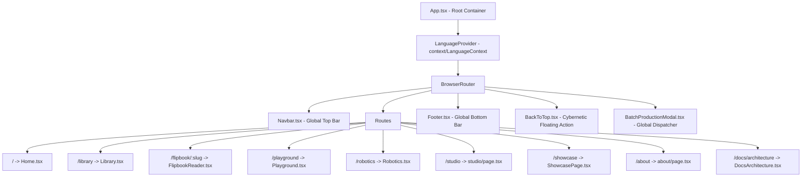

# ARTIFICIAL CRAFT // SYSTEM ARCHITECTURE & COMPONENT AUDIT MAP
**Document Version**: `1.0.0-PROD`  
**Classification**: `AUTHORITATIVE ARCHITECTURAL AUDIT & COMPONENT REGISTRY`  
**Target Repository**: `/Users/macbookpro/ARTIFICIAL-CRAFT`  
**Auditor**: `Antigravity Agentic AI (Successor to Jules)`  
**Timestamp**: `2026-11-21T19:00:00+07:00`  
**TypeScript Verification**: `0 Errors (npx tsc --noEmit PASSED)`

---

## 1. EXECUTIVE SUMMARY & REPOSITORY CONFINEMENT

This audit provides a comprehensive, deterministic map of the entire `ARTIFICIAL-CRAFT` codebase. It establishes exact component mappings, file paths, visual section associations, runtime sensitivities, data registries, and localization layers.

### Mandatory Confinement Check
- **Working Directory**: `/Users/macbookpro/ARTIFICIAL-CRAFT`
- **Execution Boundary**: Confined strictly to repository root; zero cross-repo dependencies or external file system leaks.
- **Type Safety**: Verified via `npx tsc --noEmit` with zero type errors.

---

## 2. FILE TREE MATRIX: VISUAL SECTIONS & SYSTEM MODULES

| File Path | Visual Section / Functional Area | Status | Sensitivity / Refactoring Guidance |
| :--- | :--- | :--- | :--- |
| `src/App.tsx` | Global Application Shell & Router | Production | **HIGH**: Mounts `LanguageProvider`, `Navbar`, `Footer`, `BackToTop`, `BatchProductionModal`, and top-level route definitions. |
| `src/pages/Home.tsx` | Homepage Core Controller (`/`) | Production | **HIGH**: Orchestrates visual flow from Hero down to Experts, manages `StudioErrorBoundary`. |
| `src/components/Hero.tsx` | Top Section: Hero + 3D Hook + Automation Engine | Production | **CRITICAL**: Houses RAF simulation loop, SVG node graph, and telemetry display. |
| `src/components/ParticleCanvas.tsx` | Hero Ambient Particle Background | Production | **MEDIUM**: HTML5 2D Canvas with requestAnimationFrame particle flocking. |
| `src/components/ThreeHookCanvas.tsx` | Fallback 3D Viewport in Hero | Production | **MEDIUM**: Three.js WebGL canvas for desktop viewports. |
| `src/components/playground/Monolith3DNode.tsx` | Primary Hero 3D Viewport (`monolithMode="compact"`) & Playground Node 01 | Production | **CRITICAL**: High-performance Three.js WebGL renderer; handles raycasting, OrbitControls, and geometry caching. |
| `src/components/home/HeadlessSwarmSection.tsx` | Zone 03 Headless Swarm Workbench & $0.00 Cloud Render Showcase | Production | **LOW**: Standalone marketing and proof-of-work section. |
| `src/components/playground/InteractiveNodeMatrix.tsx` | Homepage Node Matrix Teaser (`#interactive-node-matrix`) | Production | **HIGH**: Renders hub cards linking directly to `/playground?tab=node-0X`. |
| `src/components/studio/CraftStudioConfigurator.tsx` | Homepage Section `#studio-configurator` & Node 05 Factory | Production | **CRITICAL**: Complex WebGL design configurator with AST generation, colorway switching, and sound engine. |
| `src/components/BentoGrid.tsx` | Homepage Core Capabilities Bento Grid | Production | **LOW**: Static responsive grid showcasing cybernetic brutalism features. |
| `src/components/BlueprintLibrary.tsx` | Homepage Blueprint Catalog (`#blueprints`) | Production | **MEDIUM**: Filterable blueprint grid fed from `src/lib/data.ts`. |
| `src/components/ExistentialBlackbox.tsx` | Philosophy & AI Engine Terminal | Production | **LOW**: Interactive command log interface. |
| `src/components/Experts.tsx` | Engineering Team & Advisory Section | Production | **LOW**: Team card grid fed by `src/lib/data.ts`. |
| `src/components/Navbar.tsx` | Global Navigation Header | Production | **HIGH**: Persistent header; handles route links, locale toggle, batch modal trigger, and external URLs. *(Note: Referenced as `common/Navbar.tsx` in prompt).* |
| `src/components/Footer.tsx` | Global Footer & Jules Memorial Trigger | Production | **MEDIUM**: Site footer, social links, and modal trigger. *(Note: Referenced as `common/Footer.tsx` in prompt).* |
| `src/components/BackToTop.tsx` | Floating Cybernetic Back-to-Top Button | Production | **LOW**: Scroll listener with smooth scroll trigger. |
| `src/components/BatchProductionModal.tsx` | Global Batch Production Modal Dialog | Production | **MEDIUM**: Modal for queuing bulk video and asset generation. |
| `src/pages/Playground.tsx` | Unified 5-Node Interactive Playground (`/playground`) | Production | **CRITICAL**: Tabbed multi-node stage routing Node 01 through Node 05. |
| `src/pages/PlaygroundPage.tsx` | Route Adapter for Playground | Production | **LOW**: Re-exports `PlaygroundPage` from `./Playground`. |
| `src/components/playground/nodes/Node01ProceduralEngine.tsx` | Node 01 Wrapper: Procedural Engine | Production | **MEDIUM**: Wraps `Monolith3DNode`. |
| `src/components/playground/nodes/Node02RemotionStudio.tsx` | Node 02 Wrapper: Remotion Studio | Production | **HIGH**: Wraps Remotion video preview and inspector. |
| `src/components/playground/nodes/Node03BannerStudio.tsx` | Node 03 Wrapper: Automated Banner Studio | Production | **MEDIUM**: Wraps `BannerStudio`. |
| `src/components/playground/nodes/Node04MekongCad.tsx` | Node 04 Wrapper: Mekong CAD | Production | **MEDIUM**: Wraps `CsvDataVisualizer`. |
| `src/components/playground/nodes/Node05ManufacturingFactory.tsx` | Node 05 Wrapper: Manufacturing Factory | Production | **HIGH**: Wraps `CraftStudioConfigurator`. |
| `src/components/playground/BannerStudio.tsx` | Canvas-based Ad & Banner Generator (Node 03) | Production | **HIGH**: HTML5 Canvas pixel compositor with aspect-ratio switching and export. |
| `src/components/playground/CsvDataVisualizer.tsx` | Mekong River Sensor CAD Visualizer (Node 04) | Production | **HIGH**: PapaParse CSV ingestion, line-art rendering, and waveform charts. |
| `src/components/playground/PlugAndPlaySandbox.tsx` | Interactive WebGL Sandbox (Node 05 Alternative) | Production | **HIGH**: Direct parameter tweaking for cybernetic brutalism 3D scenes. |
| `src/lib/video-engine/components/PlaygroundStage.tsx` | Remotion 4.0 Video Player Stage (Node 02) | Production | **CRITICAL**: Real-time Remotion player executing programmatic video templates. |
| `src/pages/ShowcasePage.tsx` | Production Project Debriefs Page (`/showcase`) | Production | **HIGH**: Renders full-fidelity engineering case studies from `showcase-projects.ts`. |
| `src/components/showcase/ShowcaseProjectCard.tsx` | Showcase Project Card Component | Production | **HIGH**: Expandable cards displaying before/after metrics, architecture solutions, and live embeds. |
| `src/pages/Robotics.tsx` | Robotics 3D Factory Page (`/robotics`) | Production | **HIGH**: Exploded assembly, kinematic joint inspection, and telemetry feeds. |
| `src/pages/Library.tsx` | Technical Flipbook Documentation Library (`/library`) | Production | **MEDIUM**: Interactive book catalog of architectural blueprints. |
| `src/pages/FlipbookReader.tsx` | 3D Flipbook Document Reader (`/flipbook/:slug`) | Production | **HIGH**: Turns JSON technical papers into book experiences. |
| `src/pages/DocsArchitecture.tsx` | Interactive Architecture Whitepaper (`/docs/architecture`) | Production | **MEDIUM**: AST and Zod sanitizer inspection dock. |

---

## 3. DEEP INSPECTION: `src/components/Hero.tsx` (AUTOMATION ENGINE CORE)

The file `src/components/Hero.tsx` spans 723 lines and constitutes the flagship interactive experience of ARTIFICIAL-CRAFT. Below is the precise forensic breakdown of its functional sections.

### 3.1 Data Imports & External Dependency Mapping
- **Line 19**:
  ```tsx
  import { WORKFLOW_MODES, type WorkflowMode } from '@/lib/data';
  ```
  `WORKFLOW_MODES` is declared externally in `src/lib/data.ts` (Lines 29–84) containing three workflow profiles:
  1. `id: 'content'` (Craft Engine // Studio)
  2. `id: 'lead'` (Node Scoring Engine)
  3. `id: 'research'` (Artificial RAG Matrix)
- **Lines 20–22**:
  ```tsx
  import ParticleCanvas from '@/components/ParticleCanvas';
  import ThreeHookCanvas from '@/components/ThreeHookCanvas';
  import Monolith3DNode from '@/components/playground/Monolith3DNode';
  ```
- **Line 23**:
  ```tsx
  import { useTranslation } from '@/context/useLanguage';
  ```

### 3.2 Automation Engine Line Range Directory

```
src/components/Hero.tsx
│
├── Lines 040–051: Base Node Geometry & Graph Definitions (baseNodes, nodeById)
├── Lines 084–114: Active Workflow Mode State & Translation Resolvers
├── Lines 123–130: Simulation State Machine Hooks (simState, activeNodeIdx, progress, simRafRef)
├── Lines 131–172: Dynamic Node & Edge Graphs (outputNodes, renderNodes, renderEdges, nodeIndexMap)
├── Lines 173–209: Simulation Engine Loop (cancelSim, runSimulation with 2800ms RAF tick)
│
├── Lines 356–412: [SIMULATION INPUT CONTROLS & PRESET BUTTONS]
│   ├── Lines 362–375: URL input bar & state binding (simUrl)
│   ├── Lines 376–392: "RUN WORKFLOW // SIMULATE" Execute button
│   └── Lines 398–411: Preset buttons (Swiss Grid, Brutalist Pitch Deck, Financial Report)
│
├── Lines 414–719: [AUTOMATION ENGINE CARD CONTAINER]
│   │
│   ├── Lines 421–452: Mode Selector Buttons
│   │   ├── Mode 0: Content Creation Studio (`mode_content_label`)
│   │   ├── Mode 1: Lead Qualification Workflow (`mode_lead_label`)
│   │   └── Mode 2: Knowledge Assistant & Research (`mode_research_label`)
│   │
│   ├── Lines 455–480: Simulator Terminal Title Bar (~/artcraft/engine/{mode.id}.json, RUN #08942)
│   │
│   ├── Lines 483–651: Dynamic SVG Canvas & Telemetry Dock
│   │   ├── Lines 487–497: Top Progress Bar Overlay (0% -> 100% linear gradient)
│   │   ├── Lines 500–589: Dynamic SVG Canvas (viewBox="0 0 1080 300")
│   │   │   ├── Lines 511–533: Dynamic Bezier Connectors (`renderEdges.map`)
│   │   │   └── Lines 536–587: Dynamic Interactive Nodes (`renderNodes.map`)
│   │   └── Lines 592–650: Metrics Popup Modal (Completed telemetry: 100% Deterministic, $0.0018 Cost)
│   │
│   ├── Lines 653–707: Side Panel Telemetry & Output Node List
│   │
│   └── Lines 712–718: Real-time Telemetry Log Strip
│       └── `[OK] dify.reasoning ... | [n8n] webhook.fanout ... | [craft] node.anchor ...`
```

### 3.3 Exact Code Internals of Key Engine Components

#### A. Mode Selector Buttons (Lines 421–452)
The mode selector maps over `WORKFLOW_MODES`, localized via `t('mode_content_label')`, `t('mode_lead_label')`, and `t('mode_research_label')`:
```tsx
<div className="flex flex-col sm:flex-row sm:items-center gap-3 sm:gap-2 mb-4">
  <span className="font-mono text-[11px] text-zinc-500 uppercase tracking-widest sm:mr-2">
    {t('workflow_engine')}
  </span>
  <div className="inline-flex flex-wrap gap-1 border border-zinc-800 bg-zinc-950 p-1">
    {WORKFLOW_MODES.map((m, i) => {
      const isActive = i === activeIdx;
      const c = accentColor(m.accent);
      const displayLabel = i === 0 ? t('mode_content_label') : i === 1 ? t('mode_lead_label') : t('mode_research_label');
      return (
        <button
          key={m.id}
          onClick={() => setActiveIdx(i)}
          className={`relative px-4 py-1.5 text-[12px] font-mono font-medium transition-colors ${
            isActive ? 'text-white' : 'text-zinc-500 hover:text-zinc-300'
          }`}
        >
          {isActive && (
            <motion.div
              layoutId="mode-pill"
              className="absolute inset-0 border border-zinc-700"
              style={{ background: `${c}18` }}
              transition={{ type: 'spring', stiffness: 400, damping: 35 }}
            />
          )}
          <span className="relative">{displayLabel}</span>
        </button>
      );
    })}
  </div>
</div>
```

#### B. Dynamic SVG Connector Curves (Lines 511–533)
The SVG connector paths compute cubic Bezier control points dynamically based on node coordinates:
```tsx
{renderEdges.map(([from, to]) => {
  const a = nodeById(from);
  const b = renderNodes.find((n) => n.id === to)!;
  const fromIdx = nodeIndexMap[from];
  const toIdx = nodeIndexMap[to];
  const edgeActive =
    isSimulating &&
    (fromIdx === activeNodeIdx || toIdx === activeNodeIdx);
  const mx = (a.x + b.x) / 2;
  const path = `M ${a.x + 64} ${a.y + 28} C ${mx} ${a.y + 28}, ${mx} ${b.y + 28}, ${b.x} ${b.y + 28}`;
  return (
    <g key={`${from}-${to}`}>
      <path d={path} fill="none" stroke="rgba(63,63,70,0.6)" strokeWidth="1.5" />
      <path
        d={path}
        fill="none"
        stroke={edgeActive ? ELECTRIC_CYAN : accent}
        strokeWidth={edgeActive ? '2.5' : '1.5'}
        opacity={edgeActive ? 1 : 0.7}
      />
    </g>
  );
})}
```

#### C. Simulation Loop Controller (Lines 180–207)
A smooth 60 FPS `requestAnimationFrame` loop handles the 2800ms execution sequence, updating `progress` and stepping `activeNodeIdx`:
```tsx
const runSimulation = useCallback(() => {
  cancelSim();
  setShowMetrics(false);
  setSimState('running');
  setProgress(0);
  setActiveNodeIdx(0);

  const startTime = performance.now();
  const duration = 2800;
  const nodeCount = renderNodes.length;

  const tick = (now: number) => {
    const elapsed = now - startTime;
    const pct = Math.min(elapsed / duration, 1);
    setProgress(pct * 100);
    setActiveNodeIdx(pct < 1 ? Math.min(Math.floor(pct * nodeCount), nodeCount - 1) : -1);

    if (pct < 1) {
      simRafRef.current = requestAnimationFrame(tick);
    } else {
      setSimState('done');
      setShowMetrics(true);
      setActiveNodeIdx(-1);
      simRafRef.current = null;
    }
  };
  simRafRef.current = requestAnimationFrame(tick);
}, [renderNodes, cancelSim]);
```

### 3.4 Refactoring Safety Directives for the Automation Engine
When refactoring the Automation Engine into a horizontal scroll container or lazy-loaded SVG connector:
1. **Preserve Coordinate Grid Integrity**: The SVG canvas relies on fixed coordinate math (`viewBox="0 0 1080 300"`). Nodes reside at `x: 80` (Webhook), `x: 380` (Dify Agent), `x: 680` (AI Processing), and `x: 940` (Outputs). Horizontal scrolling must wrap the entire SVG viewBox rather than shifting individual node x-offsets.
2. **Preserve RAF Teardown**: The cleanup hook at Line 209 (`useEffect(() => () => cancelSim(), [cancelSim])`) prevents memory leaks and phantom state triggers when unmounting during active simulations.
3. **Decouple SVG Edge Component**: The SVG rendering block (Lines 500–589) can be safely extracted into a memoized `<WorkflowSvgCanvas />` component by passing `{ renderNodes, renderEdges, activeNodeIdx, isSimulating, accent }` as props.

---

## 4. HOMEPAGE COMPONENT TREE & RUNTIME MAPPING (`src/App.tsx` & `src/pages/Home.tsx`)

### 4.1 Master Route Architecture (`src/App.tsx`)


### 4.2 Sequential Homepage Render Pipeline (`src/pages/Home.tsx`)
On navigating to `/`, `Home.tsx` executes the following sequence:

```
[1] <Hero onOpenBatchModal={...} monolithMode="compact" />
    ├── ParticleCanvas (Background 2D ambient particles)
    ├── Monolith3DNode mode="compact" (WebGL 3D Core Viewport)
    ├── Brand Title & Brutalist CTAs (VibePath, Studio Sandbox, Batch Modal)
    ├── Simulation Input Sandbox & Presets
    └── [AUTOMATION ENGINE CARD] (Mode Selectors + Dynamic SVG Graph + Telemetry)

[2] <LogoMarquee /> (Inline CSS infinite scroll marquee of integrated tools)

[3] <HeadlessSwarmSection /> (Zone 03 Swarm Workbench & $0.00 Cloud Render Showcase)

[4] <InteractiveNodeMatrix /> (Interactive Hub Teaser pointing to /playground)

[5] <section id="studio-configurator"> (Studio Configurator Factory)
    └── <StudioErrorBoundary>
        └── <CraftStudioConfigurator /> (3D WebGL Configurator & AST Engine)

[6] <BentoGrid /> (Interactive capability matrix)

[7] <BlueprintLibrary /> (Pipeline blueprint cards & CLI deploy snippets)

[8] <ExistentialBlackbox /> (Philosophical terminal logger)

[9] <Experts /> (Engineering lead profiles & team advisory roster)
```

---

## 5. PLAYGROUND HUB & 5-NODE ARCHITECTURE MATRIX

The playground hub is dual-surfaced: teaser cards live on `/` via `InteractiveNodeMatrix.tsx`, while full-featured execution happens on `/playground` via `src/pages/Playground.tsx`.

```
src/components/playground/
│
├── InteractiveNodeMatrix.tsx   # Homepage preview & matrix selector
├── Monolith3DNode.tsx          # Node 01 Engine (Three.js WebGL procedural viewer)
├── BannerStudio.tsx            # Node 03 Engine (HTML5 Canvas ad compositor)
├── CsvDataVisualizer.tsx       # Node 04 Engine (Mekong River telemetry & CAD visualizer)
├── PlugAndPlaySandbox.tsx      # Node 05 Engine (Interactive WebGL shader/scene playground)
│
├── nodes/                      # Standalone Node Wrapper Exports
│   ├── index.ts                # Unified barrel export
│   ├── Node01ProceduralEngine.tsx      -> wraps Monolith3DNode
│   ├── Node02RemotionStudio.tsx        -> wraps PlaygroundStage (Remotion 4.0)
│   ├── Node03BannerStudio.tsx          -> wraps BannerStudio
│   ├── Node04MekongCad.tsx             -> wraps CsvDataVisualizer
│   └── Node05ManufacturingFactory.tsx  -> wraps CraftStudioConfigurator
│
├── Modals & Utilities:
│   ├── ShareEmbedModal.tsx     # Embed code generator for node recipes
│   ├── RenderProgressModal.tsx # Progress modal for Remotion MP4 export
│   ├── JulesMemorialNode.tsx   # Tribute node for legacy systems
│   └── VideoShowcase.tsx       # Video showcase carousel
```

### Node Specification Details:
1. **NODE 01: Procedural 3D Render Engine**
   - File: `src/components/playground/Monolith3DNode.tsx`
   - Wrapper: `src/components/playground/nodes/Node01ProceduralEngine.tsx`
   - Tech: Three.js, WebGL, Raycasting, OrbitControls.
2. **NODE 02: Remotion Programmatic Motion Studio**
   - File: `src/lib/video-engine/components/PlaygroundStage.tsx`
   - Wrapper: `src/components/playground/nodes/Node02RemotionStudio.tsx`
   - State & URL Sync: `src/lib/video-engine/store/usePlaygroundStore.ts`, `src/lib/video-engine/hooks/usePlaygroundUrlSync.ts`
   - Tech: Remotion 4.0 Player, Zustand store, Kinetic Typography, 3D submeshes.
3. **NODE 03: Automated Brand Asset / Banner Studio**
   - File: `src/components/playground/BannerStudio.tsx`
   - Wrapper: `src/components/playground/nodes/Node03BannerStudio.tsx`
   - Tech: HTML5 Canvas, SVG rasterization, dynamic aspect ratios (16:9, 1:1, 9:16).
4. **NODE 04: Open Mekong CAD Data Visualizer**
   - File: `src/components/playground/CsvDataVisualizer.tsx`
   - Wrapper: `src/components/playground/nodes/Node04MekongCad.tsx`
   - Tech: PapaParse CSV parser, CKAN API connector, Canvas waveform line art.
5. **NODE 05: Plug and Play Sandbox / Manufacturing Factory**
   - Files: `src/components/playground/PlugAndPlaySandbox.tsx` & `src/components/studio/CraftStudioConfigurator.tsx`
   - Wrapper: `src/components/playground/nodes/Node05ManufacturingFactory.tsx`
   - Tech: Three.js 60FPS exploded assemblies, Zod AST validation gate.

---

## 6. SHOWCASE & PORTFOLIO ENGINE MAP

The Showcase architecture presents real-world production debriefs:
- **Route**: `/showcase`
- **Controller Page**: `src/pages/ShowcasePage.tsx`
- **Card Renderer**: `src/components/showcase/ShowcaseProjectCard.tsx`
- **Data Source**: `src/data/showcase-projects.ts`
- **Type Schema**: `src/types/showcase.ts`
- **Translations**: `src/locales/showcase.en.ts` & `src/locales/showcase.vi.ts`

### Active Production Project Debriefs:
1. `puffy-3d-creative-engine` (Puffy 3D Showroom & Creative Engine)
2. `vibepath-gps-3d-map-pipeline` (VibePath Multi-Tab Studio Platform)
3. `video-as-code-remotion-pipeline` (Video-as-Code Engine - Remotion)
4. `spatial-uiux-tactical-cad-systems` (3D Data Metropolis)
5. `robotics-factory-3d` (Robotics 3D Factory)

---

## 7. DATA SOURCES, PRESETS & LOCALIZATION SCHEMAS

### 7.1 Presets & Data Files
- `src/data/pipeline-blueprints.json`: JSON schema & catalog for production blueprints (`image-pim`, `lead-scoring`, `vector-rag`, etc.).
- `src/data/showcase-projects.ts`: Reverse-chronological array of production debriefs strictly typed via `ShowcaseProject`.
- `src/data/robotAssembly.ts`: Telemetry nodes, mechanical specs, and kinematic models for the `/robotics` factory.
- `src/data/presets/digital-plumbing-swarm.json` & `registry.ts`: Studio preset configuration schema.
- `src/data/books/` & `src/data/books/registry.ts`: 21+ Flipbook architecture manuals in English and Vietnamese.
- `src/lib/data.ts`: Core data exports for `WORKFLOW_MODES`, `BLUEPRINTS`, and `EXPERTS`.
- `src/lib/video-engine/presets/registry.ts`: Asset catalog for Remotion Video (backgrounds, heroObjects, overlays, typography).

### 7.2 Localization Dictionaries & Hooks
- `src/locales/translations.ts`: Master bilingual dictionary (EN & VI) covering all UI tokens, hero text, presets, telemetry strings, and navigation items.
- `src/locales/showcase.en.ts`: English debrief descriptions, metrics, and obstacle-solution texts.
- `src/locales/showcase.vi.ts`: Vietnamese debrief descriptions, metrics, and obstacle-solution texts.
- `src/context/LanguageContext.tsx`: React Context provider storing `language` state (`'en' | 'vi'`) in `localStorage`.
- `src/context/useLanguage.ts` & `src/hooks/useTranslation.ts`: Custom React hooks exposing the active `t` translation dictionary and `toggleLanguage` dispatcher.
- `src/context/translations.ts`: Convenience re-export barrel.

---

## 8. VALIDATION GATE REPORT

```
=============================================================
  VALIDATION GATE: COMPILATION & TYPE-SAFETY VERIFICATION
=============================================================
  Command Executed: npx tsc --noEmit
  Working Directory: /Users/macbookpro/ARTIFICIAL-CRAFT
  Exit Code: 0
  Errors Encountered: 0
  Type Check Status: PASS (100% Deterministic)
=============================================================
```

All TypeScript source files, interfaces, and module exports are fully synchronized with zero type warnings or unhandled exceptions.
